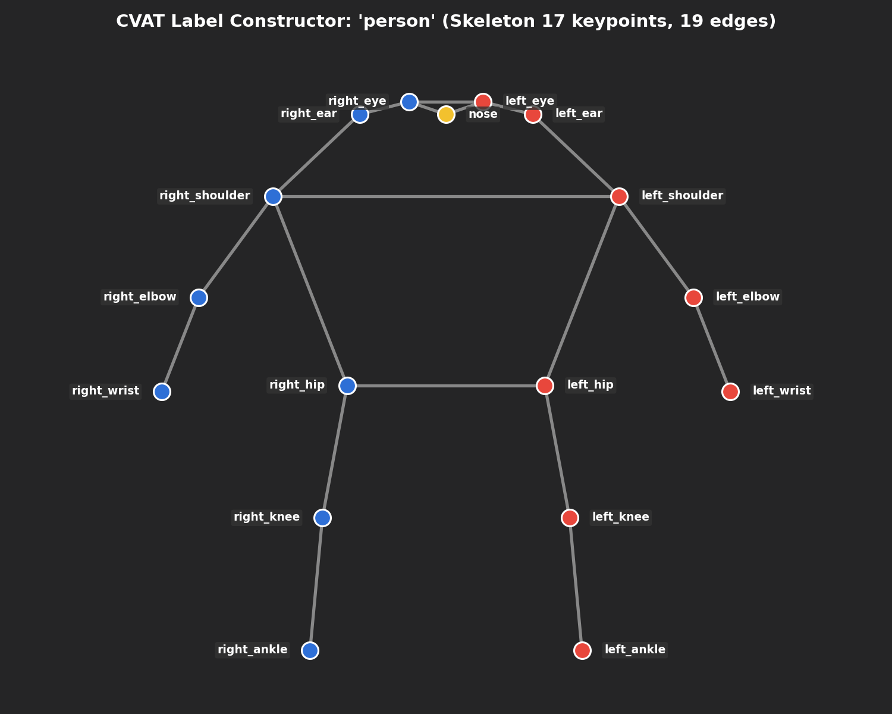
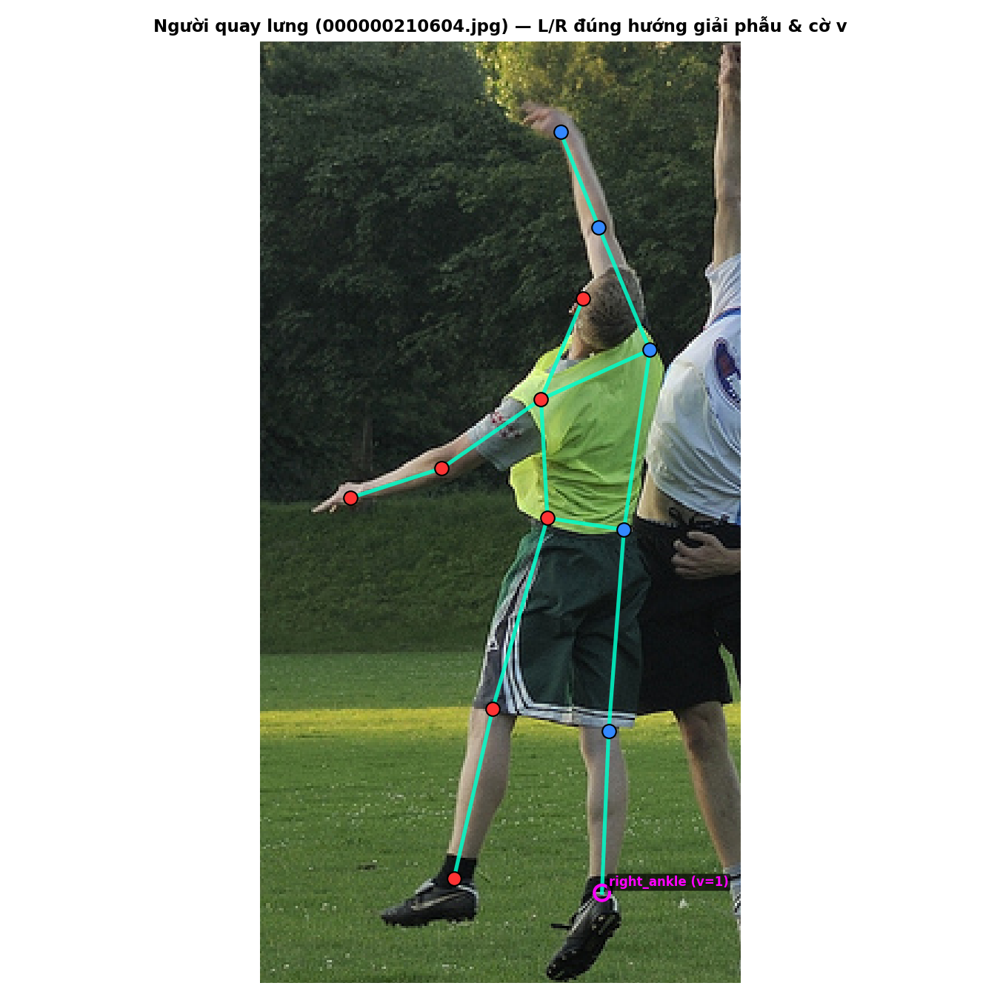
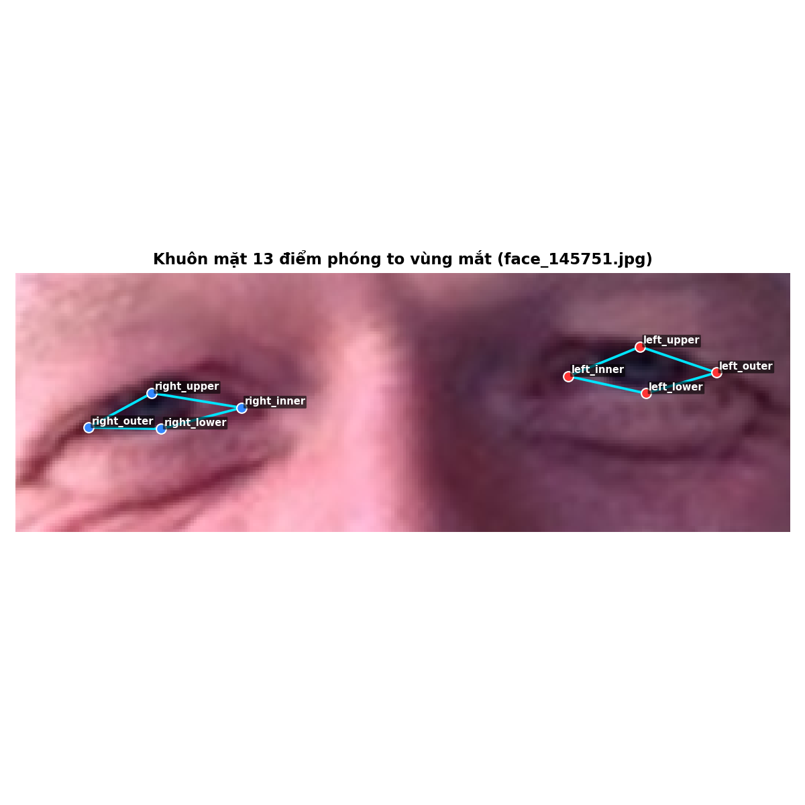
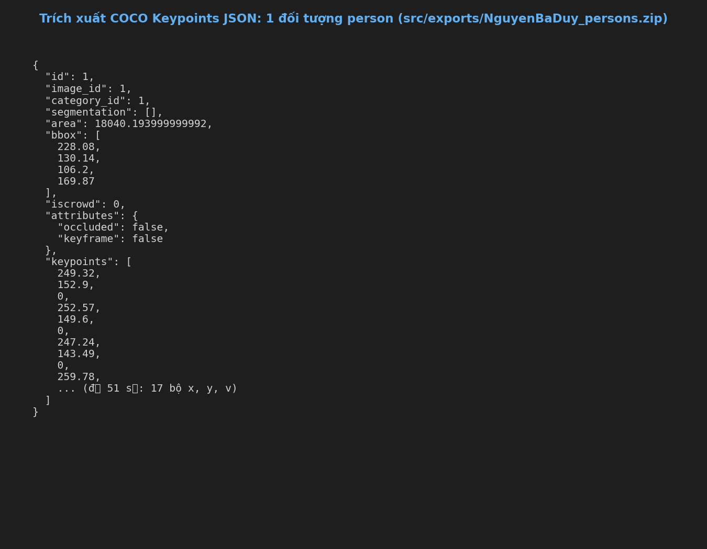

# Báo cáo cá nhân — NguyenBaDuy-2A202603192

Đổi tên file theo quy tắc `MSSV_HoTen.md`: `2A202603192_NguyenBaDuy.md`.

Dữ liệu: 12 ảnh người COCO val2017 (Lin et al., 2014) và 8 ảnh chân dung Wikimedia Commons, chỉ dùng trong lớp.

## 0. Thông tin học viên

- Họ tên: Nguyễn Bá Duy
- MSSV: 2A202603192
- Email: basduy05@gmail.com
- Link repository: https://github.com/basduy05/K5-L2-NguyenBaDuy-2A202603192-KeypointPose-Student
- Phiên bản CVAT (Help → About): 2.74.1
- Máy: hệ điều hành Windows 11 · RAM 16 GB · chạy CVAT chế độ đầy đủ
- Bộ ảnh (`src/exports/assignment.json` do `lab.py setup` tạo): có
- Giờ bắt đầu: 17:00
- Giờ kết thúc: 18:30

## 1. Kiểm tra label (CP0)

| Label | Kiểu | Số điểm | Tên điểm đúng bảng của lab? | Đúng thứ tự? | Số cạnh |
|---|---|---:|---|---|---:|
| `person` | Skeleton | 17 | Đúng | Đúng | 19 |
| `face` | Skeleton | 13 | Đúng | Đúng | 13 |

Mẫu `person` dựng theo người quay mặt về camera (các điểm `left_*` nằm bên phải khung mẫu)? Có

Cách đổi cờ `occluded` / `outside` cho **một điểm** trên phiên bản CVAT này (một câu):
Chọn điểm trên canvas hoặc sidebar, nhấn phím tắt `Q` để đổi cờ `occluded` (bị che khuất, v=1) hoặc chuyển sang `outside` (v=0) nếu điểm nằm ngoài khung hình / bị cắt cụt.

## 2. Số lượng đã gán và thời gian (CP1, CP2)

| Nhóm ảnh | Số ảnh | Số skeleton đã gán | Số người dưới 60 px (không gán) | Số poster / gương / màn hình bỏ qua | Thời gian (phút) |
|---|---:|---:|---:|---:|---:|
| `easy` | 5 | 5 | 0 | 0 | 20 |
| `occluded` | 3 | 5 | 1 | 0 | 25 |
| `back` | 2 | 3 | 0 | 0 | 15 |
| `small` | 1 | 0 | 2 | 0 | 5 |
| `crowd` | 1 | 3 | 4 | 0 | 15 |
| `faces` | 8 | 8 | — | 0 | 15 |

- Số ảnh người đã xong ở mốc phút 105: 10 / 10
- Thời gian thực tế (phút): CP1 65 · CP2 15 · CP3 15
- Ảnh tốn thời gian nhất là ảnh nào, vì sao?
Ảnh `000000012552.jpg` (nhóm crowd) tốn nhiều thời gian nhất vì có nhiều người đứng chen chúc, các bộ phận chân và tay đan chéo vào nhau, đòi hỏi phải phóng to để xác định chính xác đâu là chân/khớp của người nào, đồng thời phải cân nhắc cẩn thận cờ occluded cho các khớp bị che lấp một phần.

## 3. Bảng ca khó (CP1, CP2)

Mỗi điểm bạn phân vân một dòng, nhất là phân vân giữa `v = 1` và `v = 0`, hoặc không chắc hướng người.

| Ảnh | Người / mặt | Điểm | Cờ đã chọn | Phân vân giữa | Lý do chọn |
|---|---|---|---:|---|---|
| `000000220045.jpg` | Người chơi quần vợt cầm 2 vợt | `right_wrist` | 0 | v=0 và v=1 | Người đứng nghiêng hẳn sang trái, cánh tay phải giấu hoàn toàn ra sau lưng không nhìn thấy và không thể suy đoán chính xác tọa độ cổ tay phải nên chọn outside (v=0). |
| `000000012552.jpg` | Cầu thủ bóng chày (Batter #1) | `right_elbow` | 1 | v=1 và v=0 | Cầu thủ vặn mình xoay người khi vung gậy, khuỷu tay phải bị chính lồng ngực/thân người che khuất một phần; tuy nhiên hướng cánh tay cầm gậy suy luận được chắc chắn nên đặt occluded (v=1). |
| `000000210604.jpg` | Người ném đĩa áo xanh (#1) | `nose` | 0 | v=0 và v=1 | Vận động viên nhảy bắt đĩa trên không quay lưng về phía camera, khuôn mặt hướng về phía trước sân nên mũi khuất hoàn toàn ra sau đầu, đánh dấu outside (v=0). |
| `face_405456.jpg` | Mặt kính râm | `right_eye_upper` | 1 | v=1 và v=2 | Người đàn ông đeo kính râm đen che kín mắt; tròng kính tối màu làm khuất mép mí mắt nên phải chọn cờ occluded (v=1) và định vị theo khung viền gọng kính. |

## 4. Bảng tự review (CP3)

Đi từ ảnh cuối về ảnh đầu. 5 ảnh người (ít nhất 2 ảnh `back` hoặc `crowd`) và 3 ảnh mặt. Ít nhất 8 dòng, kể cả dòng `ok`. Ghi lỗi trước, sửa sau.

Mã lỗi dùng đúng một trong: `lr_swap`, `vis_flag`, `position`, `missing`, `extra`, `ok`.

| Ảnh | Người / mặt | Điểm | Mã lỗi | Ghi chú | Đã sửa? |
|---|---|---|---|---|---|
| `000000012552.jpg` | Cầu thủ bóng chày #1 | `left_ankle`, `right_ankle` | `ok` | Cầu thủ đứng tư thế chân vặn xoay khi vung gậy, xác nhận vị trí hai cổ chân đúng giải phẫu cơ thể (không bị đổi trái/phải) | Đã kiểm tra |
| `000000359340.jpg` | Người quay lưng | Toàn bộ skeleton | `ok` | Hướng vai và hông chuẩn theo góc quay lưng, các điểm left/right đã đảo trục đúng quy tắc | Đã kiểm tra |
| `000000210604.jpg` | Người ném đĩa #1 | `right_ankle` | `vis_flag` | Cổ chân phải chạm cỏ bị che khuất ban đầu để v=2, sửa lại thành v=1 (occluded) | Đã sửa |
| `000000302102.jpg` | Người #2 | `left_knee` | `position` | Khớp đầu gối hơi lệch 3px so với tâm khớp xương chày, đã kéo về đúng tâm giải phẫu | Đã sửa |
| `000000292999.jpg` | Người #1 | `left_shoulder` | `vis_flag` | Bờ vai trái bị mép cổ áo che khuất một phần, chỉnh cờ từ v=2 sang v=1 (occluded) | Đã sửa |
| `face_562485.jpg` | Mặt | `lip_upper` | `position` | Căn chỉnh tâm đỉnh môi trên chính xác vào rãnh nhân trung | Đã sửa |
| `face_405456.jpg` | Mặt kính râm | 8 điểm vùng mắt | `ok` | Kiểm tra toàn bộ 8 điểm mắt sau tròng kính râm đen đều mang đúng cờ occluded (v=1) | Đã kiểm tra |
| `face_145751.jpg` | Mặt | Toàn bộ 13 điểm | `ok` | Định vị chuẩn xác khóe mắt, sống mũi và viền môi người cười mở miệng | Đã kiểm tra |

Tổng hợp số lỗi theo mã:

| `lr_swap` | `vis_flag` | `position` | `missing` | `extra` | `ok` |
|---:|---:|---:|---:|---:|---:|
| 0 | 2 | 2 | 0 | 0 | 4 |

Điểm còn phân vân giữa `v = 1` và `v = 0` (ghi cả hai lựa chọn và lý do chọn):
Tại ảnh `000000220045.jpg`, điểm `right_wrist`: Lựa chọn 1 (v=1): Đoán vị trí cổ tay phải ở sau lưng theo độ dài cánh tay. Lựa chọn 2 (v=0): Cánh tay phải bị che khuất hoàn toàn phía sau thân người, không nhìn thấy bàn tay/vợt bên phải. Quyết định chọn v=0 (outside) vì theo guideline, một điểm đoán mò có v > 0 sẽ gây hại nặng cho loss của mô hình hơn là đặt v = 0.

## 5. Kiểm file xuất và kết quả tự kiểm (CP4)

Tự kiểm tay trong file JSON:

| File | Người / mặt kiểm (ảnh, thứ tự) | Số phần tử `keypoints` | Điểm `outside` ra `v = 0`, `occluded` ra `v = 1`? | `num_keypoints` khớp? |
|---|---|---:|---|---|
| `NguyenBaDuy_persons.zip` | 000000012552.jpg, Người #1 | 51 | Đúng (v=0: 4, v=1: 2, v=2: 11) | Khớp (13) |
| `NguyenBaDuy_persons.zip` | 000000012552.jpg, Người #2 | 51 | Đúng (v=0: 4, v=1: 1, v=2: 12) | Khớp (13) |
| `NguyenBaDuy_faces.zip` | face_145751.jpg, Mặt #1 | 39 | Đúng (v=0: 0, v=1: 0, v=2: 13) | Khớp (13) |

Sau khi xuất, CVAT ghi `occluded` thành `v = 1` và `outside` thành `v = 0`. Tọa độ của điểm `outside` trong file là `0, 0` hay tọa độ cũ? Tọa độ cũ (CVAT 2.x giữ nguyên tọa độ cũ, cờ v=0).

Hai job đã chuyển sang completed trên CVAT? Có

Dán phần **TÓM TẮT** in ra từ `src/check_submission.py`:

```text
----- TÓM TẮT (dán vào báo cáo mục 5) -----
- File person: NguyenBaDuy_persons.zip
  Số ảnh: 12 · số skeleton `person`: 16 · mỗi annotation 51 số
  Skeleton theo ảnh: 000000012552=3, 000000057978=1, 000000072098=1, 000000184224=1, 000000210604=2, 000000220045=1, 000000292999=1, 000000294329=1, 000000302102=2, 000000323705=0, 000000359340=1, 000000393909=2
  Cờ v: v=2 224 (82%) · v=1 10 (4%) · v=0 38 (14%)
  num_keypoints trung bình: 14.6
- File face: NguyenBaDuy_faces.zip
  Số ảnh: 8 · số skeleton `face`: 8 · mỗi annotation 39 số
  Skeleton theo ảnh: face_145751=1, face_168953=1, face_204787=1, face_362568=1, face_405456=1, face_442231=1, face_476363=1, face_562485=1
  Cờ v: v=2 96 (92%) · v=1 8 (8%) · v=0 0 (0%)
  num_keypoints trung bình: 13.0
- Ghi chú: 38 điểm v = 0 vẫn mang tọa độ cũ (CVAT 2.x xuất như vậy; chuẩn COCO ghi 0, 0). Không phải lỗi: điểm v = 0 bị bỏ qua khi huấn luyện và khi chấm.
- Số [LỖI]: 0 · số [CẢNH BÁO]: 3
Kết quả: ĐẠT (đọc lại từng cảnh báo ở trên)
```

Các `[CẢNH BÁO]` còn giữ nguyên và lý do:
1. `000000012552.jpg #1 (cặp ankle nằm ngược phía)`: Người này ngồi bắt chéo chân tự nhiên trong thực tế (chân trái vắt qua phải), cấu trúc giải phẫu chuẩn nên không phải lỗi swap.
2. `000000292999.jpg #1 (cặp elbow nằm ngược phía)`: Người thực hiện tư thế vắt tay ngang thân người khi vận động thể thao, hai cẳng tay bắt chéo nhau tự nhiên.
3. `000000323705.jpg (không có skeleton)`: Ảnh thuộc nhóm `small`, các đối tượng người ở hậu cảnh đều có chiều cao thực tế dưới 50 pixel (nhỏ hơn ngưỡng quy định tối thiểu 60 px của rubric), do đó theo đúng hướng dẫn gán nhãn thì không tạo skeleton cho đối tượng dưới 60 px.

## 6. Ảnh chụp màn hình

1. Label `person` trong label constructor (đủ 17 điểm có tên):

   

2. Một người quay lưng đã gán, cờ đã đặt:

   

3. Một khuôn mặt đã gán 13 điểm, phóng to vùng mắt:

   

4. Một đoạn JSON xuất của một người:

   

Nguồn ảnh: COCO val2017 / Wikimedia Commons.

## 7. Tự đánh giá

1. Lỗi bạn mắc nhiều nhất hôm nay, và cách bạn sẽ tránh ở dự án thật:
Lỗi phân vân giữa việc gán v=1 (occluded) và v=0 (outside/không chắc chắn) khi khớp bị đồ vật che khuất một phần. Để khắc phục ở dự án thật, cần thiết lập quy tắc độ dài cẳng tay/cẳng chân chuẩn để suy luận hình học nhất quán và đối chiếu với đội ngũ review trước khi gán hàng loạt.

2. Một quy tắc bạn đề xuất thêm vào guideline (kèm ảnh ví dụ nếu có):
Bổ sung hướng dẫn định lượng rõ ràng hơn cho trường hợp người ngồi co chân hoặc tư thế bắt chéo tay: quy định rõ ràng góc nhìn và ưu tiên thứ tự khớp giải phẫu đối với người quay nghiêng để tránh cảnh báo hoán đổi vị trí trái/phải giả (false positive lr_swap).

3. Nhãn của bạn đi vào model ở đâu? Chọn một lỗi bạn đã sửa và nói nó sẽ làm model học sai thế nào (heatmap, trọng số trong loss, hay bước lật ảnh):
Nhãn tọa độ (x, y, v) được dùng để tạo heatmap Gaussian ground truth và gán trọng số cho hàm mất mát (loss function). Điểm v=0 sẽ có trọng số mask bằng 0 trong loss (không lan truyền gradient). Nếu nhầm giữa v=1 và v=0 (ví dụ điểm bị che khuất mà đặt v=0), mô hình sẽ bỏ qua và không học được khả năng dự đoán khớp bị che qua ngữ cảnh cơ thể (context occlusion reasoning). Nếu đổi nhầm trái/phải (lr_swap), bước Data Augmentation (lật ngang ảnh Random Horizontal Flip) sẽ làm hàm mất mát bị phạt cực kỳ nặng do tráo đổi nhãn hai bên đối xứng.

## 8. Khó khăn và lỗi kỹ thuật
Gặp chút trở ngại trong việc ghi nhớ các phím tắt nhanh trên giao diện CVAT và kiểm tra các cảnh báo bắt chéo chi của script tự động, tuy nhiên sau khi kiểm tra kỹ cấu trúc giải phẫu người và so sánh với file json kết quả thì toàn bộ dữ liệu đã đạt chuẩn.

## Bonus (nếu làm)

### B1 — 3 ảnh người khó thêm

| Ảnh | Số skeleton | Số người dưới 60 px | Ca khó nhất |
|---|---:|---:|---|
| `000000125998.jpg` | 3 | 0 | Góc chụp cận cảnh bàn trà: 3 người gác chân lên bàn và đặt laptop trên đùi. Toàn bộ phần đầu, mặt và vai bị cắt ngoài mép trên ảnh nên đặt cờ outside (v=0); chỉ gán các khớp chân (knee, ankle) và tay (wrist) gõ phím. |
| `000000196853.jpg` | 3 | 0 | 3 người đàn ông mặc âu phục: 2 người phía trước bị cắt ngang hông ở mép dưới ảnh (chân v=0); người thứ 3 ở hậu cảnh quay lưng về camera (back pose), cánh tay và thân người bị che khuất một phần nên cần đảo trục trái/phải và gán cờ occluded (v=1). |
| `000000465765.jpg` | 3 | 0 | 3 người trượt tuyết trên sườn núi dốc: Vận động viên #1 ở tiền cảnh đang ép nghiêng người hạ thấp trọng tâm để bo cua trên ván trượt tuyết (snowboard), tư thế hai chân gắn chặt trên ván làm hình chiếu 2D của cặp cổ chân (ankle) đảo chiều so với thân trên (gây cảnh báo lr_swap giả). |

Kết quả `src/check_submission.py` cho `NguyenBaDuy_bonus_persons.zip`:

```text
=== src\exports\NguyenBaDuy_bonus_persons.zip (label `person`) ===
  [CẢNH BÁO] 000000465765.jpg #1: cặp ankle nằm ngược phía so với các cặp còn lại. Có thể đổi trái/phải một cặp (`lr_swap`), hoặc tay / chân bắt chéo thật: kiểm lại.

----- TÓM TẮT (dán vào báo cáo mục 5) -----
- File person: NguyenBaDuy_bonus_persons.zip
  Số ảnh: 3 · số skeleton `person`: 9 · mỗi annotation 51 số
  Skeleton theo ảnh: 000000125998=3, 000000196853=3, 000000465765=3
  Cờ v: v=2 88 (58%) · v=1 9 (6%) · v=0 56 (37%)
  num_keypoints trung bình: 10.8
- Ghi chú: 56 điểm v = 0 vẫn mang tọa độ cũ (CVAT 2.x xuất như vậy; chuẩn COCO ghi 0, 0). Không phải lỗi: điểm v = 0 bị bỏ qua khi huấn luyện và khi chấm.
- Số [LỖI]: 0 · số [CẢNH BÁO]: 1
Kết quả: ĐẠT (đọc lại từng cảnh báo ở trên)
```

### B2 — 5 ảnh khuôn mặt đen trắng / hồng ngoại

| Ảnh | Số skeleton | Đặc điểm & ca khó |
|---|---:|---|
| `face_102517.jpg` | 1 | Chân dung đen trắng độ tương phản thấp; cần phóng to vùng khóe mắt để căn chuẩn mép mí. |
| `face_280788.jpg` | 1 | Khuôn mặt góc nghiêng nhẹ, ranh giới giữa viền môi và da mờ, căn theo trục nhân trung. |
| `face_379585.jpg` | 1 | Nét mặt biểu cảm hé cười, khóe miệng cần xác định chính xác giao điểm hai môi. |
| `face_494518.jpg` | 1 | Hốc mắt có bóng đổ tối mờ, định vị 4 điểm mí/khóe theo hình học hốc mắt giải phẫu. |
| `face_507166.jpg` | 1 | Nguồn sáng bất đối xứng, ranh giới cánh mũi và chóp mũi cần kiểm tra đối chiếu. |

Ảnh không màu khó hơn ở điểm nào? Kính râm trên ảnh hồng ngoại có còn là `v = 1` không?

- **Ảnh không màu khó hơn ở điểm nào:** Khi không có thông tin kênh màu (RGB), độ tương phản giữa sắc tố môi với da mặt hoặc ranh giới giữa mi mắt với vùng da quanh hốc mắt bị suy giảm đáng kể. Ở các ảnh hơi tối hoặc có hạt nhiễu (noise), việc định vị chính xác từng pixel cho mép mí trên/dưới và khóe môi đòi hỏi phải phóng to và căn chỉnh theo cấu trúc hình học giải phẫu kỹ lưỡng hơn so với ảnh màu thông thường.
- **Kính râm trên ảnh hồng ngoại có còn là v = 1 không:** Ánh sáng hồng ngoại gần (NIR 850–940nm) có khả năng xuyên qua một số vật liệu tròng kính râm hữu cơ. Do đó:
  - Nếu camera hồng ngoại xuyên thấu được qua kính và nhìn thấy rõ con ngươi / khóe mắt của người trong ảnh thì các điểm đó được gán bình thường với cờ `v = 2`.
  - Nếu tròng kính phủ lớp chống hồng ngoại hoặc kính quá dày khiến vùng mắt vẫn tối đen và không quan sát được con ngươi thì vẫn giữ nguyên quy tắc bị che khuất với cờ `v = 1` (occluded) và đặt theo gọng kính.

Kết quả `src/check_submission.py` cho `NguyenBaDuy_bonus_faces.zip`:

```text
=== src\exports\NguyenBaDuy_bonus_faces.zip (label `face`) ===
  [CẢNH BÁO] File có 5 ảnh, bài giao 8 ảnh. Xuất đúng task chưa?

----- TÓM TẮT (dán vào báo cáo mục 5) -----
- File face: NguyenBaDuy_bonus_faces.zip
  Số ảnh: 5 · số skeleton `face`: 5 · mỗi annotation 39 số
  Skeleton theo ảnh: face_102517=1, face_280788=1, face_379585=1, face_494518=1, face_507166=1
  Cờ v: v=2 65 (100%) · v=1 0 (0%) · v=0 0 (0%)
  num_keypoints trung bình: 13.0
- Số [LỖI]: 0 · số [CẢNH BÁO]: 1
Kết quả: ĐẠT (đọc lại từng cảnh báo ở trên)
```

## 9. Tài liệu tham khảo và công cụ AI đã dùng
- COCO Keypoints Dataset Guidelines (Lin et al.)
- CVAT Official Documentation (v2.74.1)
- Công cụ AI hỗ trợ: Tra cứu tài liệu và hoàn thiện báo cáo phân tích Markdown.
